# 🗄️ Modelo de Banco de Dados — Bloco Bicharada (Vercel Postgres / Neon)

Este documento especifica a modelagem relacional completa do aplicativo do **Bloco Bicharada / Bixarada Floripa 2027**, projetada para rodar **100% no plano gratuito da Vercel** (*Vercel Postgres powered by Neon* ou *Supabase Free*).

---

## 📐 1. Diagrama Entidade-Relacionamento (ERD)

```mermaid
erDiagram
    INTEGRANTES {
        uuid id PK
        varchar nome
        varchar grande_grupo
        varchar instrumento_funcao
        text observacao
        boolean ativo
        timestamp criado_em
    }

    TAREFAS_POSTIT {
        uuid id PK
        varchar titulo
        text descricao
        varchar categoria
        varchar responsavel
        varchar cor_postit
        boolean urgente
        boolean concluida
        timestamp criado_em
    }

    MUSICAS_REPERTORIO {
        uuid id PK
        varchar titulo
        varchar artista_original
        varchar ritmo
        integer ordem_desfile
        integer votos_favoraveis
        varchar status_curadoria
        text audio_guia_url
        text letra
        timestamp criado_em
    }

    LETRAS_CIFRAS {
        uuid id PK
        varchar titulo
        varchar tipo
        varchar autor_upload
        date data_upload
        text conteudo_texto
        text arquivo_url
    }

    BILHETES_RIFA {
        integer numero PK
        varchar status
        varchar comprador_nome
        varchar comprador_whats
        timestamp data_reserva
        timestamp data_pagamento
        varchar comprovante_ref
    }

    MACROTAREFAS_DESFILE {
        uuid id PK
        varchar titulo
        varchar coluna
        varchar responsavel_principal
        text descricao
        integer ordem
        timestamp criado_em
    }

    SUBTAREFAS_CHECKLIST {
        uuid id PK
        uuid macrotarefa_id FK
        text texto
        boolean concluido
        integer ordem
    }

    MOVIMENTOS_BAR {
        uuid id PK
        date data
        varchar descricao
        varchar tipo
        varchar categoria
        numeric valor
        varchar responsavel
        timestamp criado_em
    }

    ENQUETES_WHATSAPP {
        uuid id PK
        varchar titulo
        text pergunta
        text resolucao_oficial
        integer total_votos
        date data_encerramento
        timestamp criado_em
    }

    ENQUETE_OPCOES {
        uuid id PK
        uuid enquete_id FK
        varchar rotulo
        integer votos
        integer percentual
    }

    EVENTOS_CALENDARIO {
        uuid id PK
        date data
        varchar dia_semana
        varchar tipo
        varchar local
        varchar horario
        text observacoes
    }

    MACROTAREFAS_DESFILE ||--o{ SUBTAREFAS_CHECKLIST : "possui sub-itens"
    ENQUETES_WHATSAPP ||--o{ ENQUETE_OPCOES : "possui opções de voto"
```



---

## 📜 2. Script DDL Oficial (PostgreSQL / Vercel Postgres)

```sql
-- Habilita extensão para geração de UUID
CREATE EXTENSION IF NOT EXISTS "uuid-ossp";

-- 1. Tabela de Integrantes (Elenco e Naipes)
CREATE TABLE IF NOT EXISTS integrantes (
    id UUID PRIMARY KEY DEFAULT uuid_generate_v4(),
    nome VARCHAR(150) NOT NULL,
    grande_grupo VARCHAR(50) NOT NULL CHECK (grande_grupo IN ('Bateria', 'Sopros', 'Vozes', 'Outros Instrumentos', 'Brincantes & Dança', 'Organização & Apoio')),
    instrumento_funcao VARCHAR(100) NOT NULL,
    observacao TEXT,
    ativo BOOLEAN DEFAULT TRUE,
    criado_em TIMESTAMP WITH TIME ZONE DEFAULT CURRENT_TIMESTAMP
);

CREATE INDEX idx_integrantes_grupo ON integrantes(grande_grupo);
CREATE INDEX idx_integrantes_instrumento ON integrantes(instrumento_funcao);

-- 2. Tabela de Tarefas e Recados (Mural de Post-its & Cortiça)
CREATE TABLE IF NOT EXISTS tarefas_postit (
    id UUID PRIMARY KEY DEFAULT uuid_generate_v4(),
    titulo VARCHAR(200) NOT NULL,
    descricao TEXT,
    categoria VARCHAR(50) NOT NULL CHECK (categoria IN ('Apoio', 'Logística', 'Produção', 'Música', 'Comunicação', 'Fantasias')),
    responsavel VARCHAR(150) DEFAULT '', -- Se vazio ou nulo, é considerada Tarefa Órfã
    cor_postit VARCHAR(20) DEFAULT 'rosa' CHECK (cor_postit IN ('rosa', 'verde', 'amarelo', 'azul')),
    urgente BOOLEAN DEFAULT FALSE,
    concluida BOOLEAN DEFAULT FALSE,
    criado_em TIMESTAMP WITH TIME ZONE DEFAULT CURRENT_TIMESTAMP
);

CREATE INDEX idx_tarefas_responsavel ON tarefas_postit(responsavel);
CREATE INDEX idx_tarefas_concluida ON tarefas_postit(concluida);

-- 3. Tabela de Repertório e Votação de Músicas
CREATE TABLE IF NOT EXISTS musicas_repertorio (
    id UUID PRIMARY KEY DEFAULT uuid_generate_v4(),
    titulo VARCHAR(150) NOT NULL,
    artista_original VARCHAR(150) NOT NULL,
    ritmo VARCHAR(80) NOT NULL,
    ordem_desfile INTEGER NOT NULL DEFAULT 99,
    votos_favoraveis INTEGER NOT NULL DEFAULT 0,
    status_curadoria VARCHAR(50) NOT NULL DEFAULT 'Em Votação' CHECK (status_curadoria IN ('Confirmada', 'Em Votação', 'Sugerida para Corte')),
    audio_guia_url TEXT,
    letra TEXT,
    criado_em TIMESTAMP WITH TIME ZONE DEFAULT CURRENT_TIMESTAMP
);

CREATE INDEX idx_musicas_ordem ON musicas_repertorio(ordem_desfile);

-- 4. Tabela do Caderno de Letras e Cifras
CREATE TABLE IF NOT EXISTS letras_cifras (
    id UUID PRIMARY KEY DEFAULT uuid_generate_v4(),
    titulo VARCHAR(200) NOT NULL,
    tipo VARCHAR(50) NOT NULL CHECK (tipo IN ('Cifra', 'Letra', 'Partitura')),
    autor_upload VARCHAR(150) NOT NULL,
    data_upload DATE NOT NULL DEFAULT CURRENT_DATE,
    conteudo_texto TEXT,
    arquivo_url TEXT,
    criado_em TIMESTAMP WITH TIME ZONE DEFAULT CURRENT_TIMESTAMP
);

-- 5. Tabela da Rifa 100% Online (Cartela 001 a 500)
CREATE TABLE IF NOT EXISTS bilhetes_rifa (
    numero INTEGER PRIMARY KEY CHECK (numero BETWEEN 1 AND 500),
    status VARCHAR(30) NOT NULL DEFAULT 'Disponível' CHECK (status IN ('Disponível', 'Reservado', 'Pago')),
    comprador_nome VARCHAR(150),
    comprador_whats VARCHAR(50),
    data_reserva TIMESTAMP WITH TIME ZONE,
    data_pagamento TIMESTAMP WITH TIME ZONE,
    comprovante_ref TEXT
);

CREATE INDEX idx_rifa_status ON bilhetes_rifa(status);

-- 6. Tabela do Kanban do Desfile & Kombi Cora (Macrotarefas)
CREATE TABLE IF NOT EXISTS macrotarefas_desfile (
    id UUID PRIMARY KEY DEFAULT uuid_generate_v4(),
    titulo VARCHAR(200) NOT NULL,
    coluna VARCHAR(50) NOT NULL DEFAULT 'A Fazer' CHECK (coluna IN ('A Fazer', 'No Dia do Desfile', 'Concluído na Avenida')),
    responsavel_principal VARCHAR(150) NOT NULL,
    descricao TEXT,
    ordem INTEGER DEFAULT 0,
    criado_em TIMESTAMP WITH TIME ZONE DEFAULT CURRENT_TIMESTAMP
);

-- 7. Sub-tarefas / Checklists das Macrotarefas do Desfile
CREATE TABLE IF NOT EXISTS subtarefas_checklist (
    id UUID PRIMARY KEY DEFAULT uuid_generate_v4(),
    macrotarefa_id UUID NOT NULL REFERENCES macrotarefas_desfile(id) ON DELETE CASCADE,
    texto TEXT NOT NULL,
    concluido BOOLEAN DEFAULT FALSE,
    ordem INTEGER DEFAULT 0
);

CREATE INDEX idx_checklist_macro ON subtarefas_checklist(macrotarefa_id);

-- 8. Tabela de Movimentações do Bar dos Ensaios (Livro Caixa)
CREATE TABLE IF NOT EXISTS movimentos_bar (
    id UUID PRIMARY KEY DEFAULT uuid_generate_v4(),
    data DATE NOT NULL DEFAULT CURRENT_DATE,
    descricao VARCHAR(250) NOT NULL,
    tipo VARCHAR(30) NOT NULL CHECK (tipo IN ('Entrada', 'Saída')),
    categoria VARCHAR(100) NOT NULL CHECK (categoria IN ('Venda de Cerveja / Bebidas', 'Compra no Atacado (Fort)', 'Isopor da Peixaria', 'Gelo', 'Outros')),
    valor NUMERIC(10, 2) NOT NULL CHECK (valor > 0),
    responsavel VARCHAR(150) NOT NULL,
    criado_em TIMESTAMP WITH TIME ZONE DEFAULT CURRENT_TIMESTAMP
);

CREATE INDEX idx_bar_tipo ON movimentos_bar(tipo);
CREATE INDEX idx_bar_data ON movimentos_bar(data);

-- 9. Tabela de Enquetes Apuradas do WhatsApp
CREATE TABLE IF NOT EXISTS enquetes_whatsapp (
    id UUID PRIMARY KEY DEFAULT uuid_generate_v4(),
    titulo VARCHAR(200) NOT NULL,
    pergunta TEXT NOT NULL,
    resolucao_oficial TEXT,
    total_votos INTEGER NOT NULL DEFAULT 0,
    data_encerramento DATE NOT NULL DEFAULT CURRENT_DATE,
    criado_em TIMESTAMP WITH TIME ZONE DEFAULT CURRENT_TIMESTAMP
);

-- 10. Opções e Votos das Enquetes
CREATE TABLE IF NOT EXISTS enquete_opcoes (
    id UUID PRIMARY KEY DEFAULT uuid_generate_v4(),
    enquete_id UUID NOT NULL REFERENCES enquetes_whatsapp(id) ON DELETE CASCADE,
    rotulo VARCHAR(200) NOT NULL,
    votos INTEGER NOT NULL DEFAULT 0,
    percentual INTEGER NOT NULL DEFAULT 0
);

CREATE INDEX idx_opcoes_enquete ON enquete_opcoes(enquete_id);

-- 11. Tabela do Calendário de Ensaios & Datas
CREATE TABLE IF NOT EXISTS eventos_calendario (
    id UUID PRIMARY KEY DEFAULT uuid_generate_v4(),
    data DATE NOT NULL,
    dia_semana VARCHAR(10) NOT NULL,
    tipo VARCHAR(50) NOT NULL CHECK (tipo IN ('Ensaio', 'Reunião presencial', 'Oficina de Fantasias', 'Desfile Oficial')),
    local VARCHAR(150) NOT NULL,
    horario VARCHAR(20) NOT NULL,
    observacoes TEXT
);

CREATE INDEX idx_calendario_data ON eventos_calendario(data);
```

---

## ⚡ 3. Como Conectar na Vercel (Hospedagem 100% Gratuita)

1. **Ativar Vercel Postgres:**
   - No painel da Vercel (`vercel.com`), abra seu projeto e clique na aba **Storage**.
   - Clique em **Create Database** e selecione **Postgres (Neon)**.
   - Escolha o plano **Hobby (Free - $0/mês)**.
2. **Variáveis de Ambiente Automáticas:**
   - A Vercel adicionará automaticamente as variáveis ao projeto:
     - `POSTGRES_URL`
     - `POSTGRES_PRISMA_URL`
     - `POSTGRES_URL_NON_POOLING`
3. **Execução das Migrations / Scripts:**
   - O script SQL acima pode ser executado diretamente na aba **Query** do painel da Vercel ou via biblioteca leve `@vercel/postgres` em Serverless Route Handlers (`src/app/api/...`).

